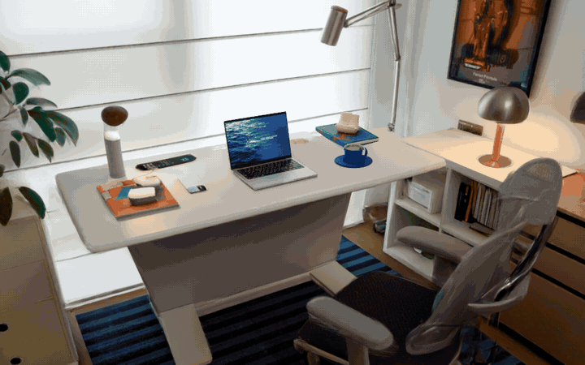
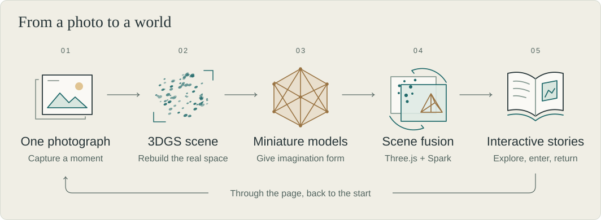

# Backside Universe · backside-universe

[简体中文](README.md) | **English**

A photograph can hold more than a moment. It can carry the hopes and imagination you bring to it. **Backside Universe lets the other side of a photograph grow into a 3D world you can step inside.**

[Open the photo album](https://backside-universe.netlify.app/?lang=en) · [Run locally](#run-locally) · [Developer documentation](photo-demo/docs/README.md)

[](https://backside-universe.netlify.app/?lang=en#desk)

Move around the photographed scene and discover everyday objects transformed into islands. Step inside a bookroom in the cave, where a page on the desk leads back to the beginning.

Use the **中文 / English** control in the header to choose your language; your choice is remembered. For your first visit, select **Follow the story**. High-resolution scenes take time to load on the first visit; download progress and preparation stages appear on screen.

## Projects

| Project | The world behind the photograph | Explore |
| --- | --- | --- |
| **A Holiday Behind the Desk** | A desk becomes an ocean, with a cup, two books, a phone, and a laptop forming five islands. Send a paper boat out to sea, silence the demands of work, and return to your desk through a book page. | [Play online](https://backside-universe.netlify.app/?lang=en#desk) · [Project status](PROJECT_STATUS.md) |
| **The Dog's Body Museum** | Move around a dog to discover six miniature galleries inside its body. Follow the journey of food and explore the worlds within its organs. | [Play online](https://backside-universe.netlify.app/?lang=en#canine) · [Project and setup notes](photo-demo/docs/CANINE_MUSEUM.md) |
| **Grandma Always Sets Another Pair of Chopsticks** | Walk around the handle of the enamel pot, pull out the bamboo stool, and take a seat at the family table. | [Play online](https://backside-universe.netlify.app/?lang=en#grandmas-table) |
| **Rewind to the Final Bell** | Turn the pencil to wind the last shot back into a student’s hands, then step through the radio room window onto the basketball court. | [Play online](https://backside-universe.netlify.app/?lang=en#after-school-rewind) |

## Experience

- **Discover the other side for yourself.** Move continuously from the reconstructed scene into a miniature world, revealed through changing viewpoints, occlusion, and scale.
- **Small gestures change a whole world.** Coffee steam becomes clouds, a desk lamp guides sunrise and sunset, and an underwater world extends beneath the desk.
- **Step into places and stories.** Travel between islands, climb stairs, open doors, and fold a note demanding more work into a paper boat you can send away.
- **Return to the beginning.** The bookroom's open book carries the original photograph. Enter that page to return to the same 3DGS workspace.

## How it works

We first reconstruct the photographed scene with 3D Gaussian Splatting (3DGS), then model its subjects and the imagined miniature spaces behind them. After aligning the models' positions, scale, and original viewpoint, Three.js and Spark bring the splats and meshes together. Continuous camera movement connects exploration, interaction, and the return to the original scene.

<picture>
  <source media="(max-width: 600px)" srcset="docs/diagrams/photo-to-world-mobile.en.svg">
  
</picture>

## Run locally

You need Node.js and a browser with WebGL2 support. **After cloning, follow the [asset restoration guide](photo-demo/docs/ASSETS.md) to restore the photographs, models, Gaussian scenes, and runtime dependencies.** Then run these commands from the repository root:

```sh
cd photo-demo
npm run dev
```

Once the server starts, open [the photo album](http://127.0.0.1:9988/) and choose a photograph to enter its world. Return to the album and reopen a project in the same tab to resume your previous view. You can also open [the desk experience](http://127.0.0.1:9988/marble-transition-lab/index.html) directly. See the [development guide](photo-demo/docs/DEVELOPMENT.md) for environment setup and validation commands.

## Status and next steps

All four works are live in the album. New screenings ship with the scene library and appear through the catalog. The [deployment guide](photo-demo/deploy/README.md) covers publishing a new photograph, storage and rollback.

Our next priorities are improving models and paths at close range, reducing initial loading and scene transition waits, and validating the complete journey on real mobile devices. See the [project status and plan](PROJECT_STATUS.md).

## Documentation

Detailed development notes are currently in Chinese.

| Topic | Start here |
| --- | --- |
| Local development and validation | [Development guide](photo-demo/docs/DEVELOPMENT.md) |
| Restoring the full experience | [Assets and dependencies](photo-demo/docs/ASSETS.md) |
| Connecting splats and meshes | [Scene transitions](photo-demo/docs/MARBLE_TRANSITION.md) · [The book-page loop](photo-demo/docs/BOOKROOM_LOOP.md) |
| Production notes, earlier versions, and research | [Documentation index](photo-demo/docs/README.md) |

## Credits and licensing

Rendering uses [Three.js](https://github.com/mrdoob/three.js) and [Spark](https://github.com/sparkjsdev/spark). Underwater motion draws on [Abyssal Living Deep](https://github.com/emollick/abyssal-living-deep), with scanned materials from [Poly Haven](https://polyhaven.com/).

See [assets and dependencies](photo-demo/docs/ASSETS.md) for third-party licenses and asset sources. Original photographs, models, and generated assets are not distributed with the source repository. The repository does not currently have a project-wide license.
