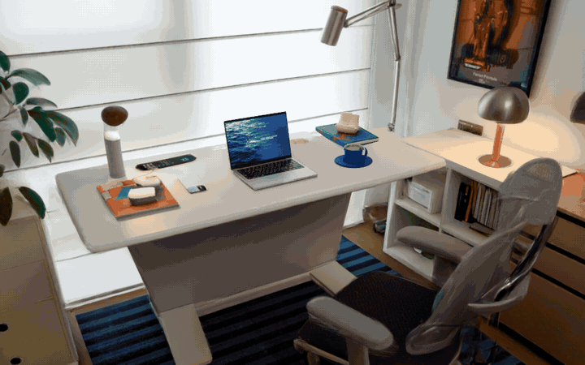
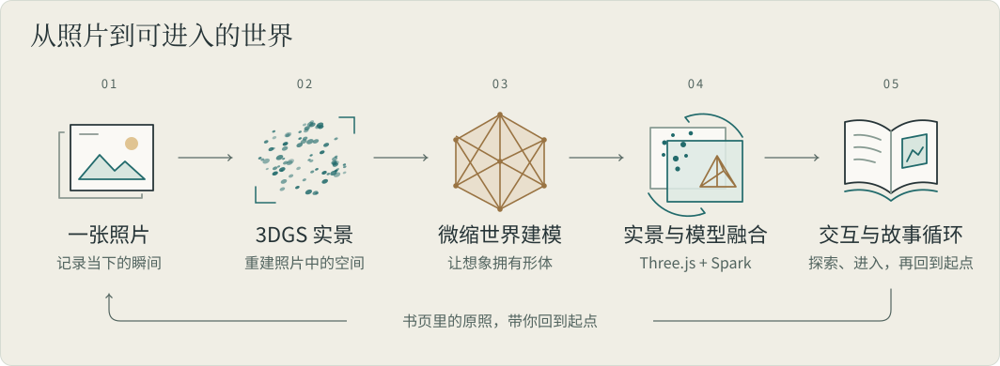

# 背后宇宙 · backside-universe

**简体中文** | [English](README.en.md)

一张照片，不仅可以记录当下的瞬间，也可以承载你再次看见它时的希望与想象。**背后宇宙，让照片的背面生长出可以走进去的 3D 世界。**

[打开放映相簿](https://backside-universe.netlify.app/?lang=zh) · [本地运行](#本地运行) · [开发文档](photo-demo/docs/README.md)

[](https://backside-universe.netlify.app/?lang=zh#desk)

绕到照片背后，日常的物件成为岛屿。走进洞窟里的书屋，桌上那一页又把你带回故事的起点。

可在右上角切换中文 / English，语言选择会保留。第一次体验，建议点击「跟随故事」。高清场景首次加载需要一些时间，页面会显示下载进度与准备状态。

## 作品集

| 作品 | 照片背后的世界 | 体验入口 |
| --- | --- | --- |
| **工位背后的假期** | 书桌变成海洋，杯子、书本、手机与电脑成为五座岛。放走一艘纸船，拨掉工作的声音，再从书页回到工位。 | [在线体验](https://backside-universe.netlify.app/?lang=zh#desk) · [作品现状](PROJECT_STATUS.md) |
| **小狗身体博物馆** | 绕到小狗身侧，发现身体里的六座微缩展馆；沿着食物的旅程，进入器官内部探索。 | [在线体验](https://backside-universe.netlify.app/?lang=zh#canine) · [作品与运行说明](photo-demo/docs/CANINE_MUSEUM.md) |

## 体验亮点

- **亲手发现照片的背面。** 从实景连续绕到微缩世界，通过转动、遮挡与尺度变化逐步揭示它。
- **小动作改变一片天地。** 咖啡的热气凝成云，台灯牵动日出日落，桌面下延伸出海底。
- **走进景物，也走进故事。** 在岛屿间游览，走上楼梯、打开房门，把催促工作的纸条折成纸船送走。
- **回到开始，再次出发。** 书屋里的书页印着原始照片；进入那一页，又回到最初的 3DGS 工位。

## 如何实现

先从照片重建 3D Gaussian Splatting（3DGS）实景，再为照片中的主体及其背后的想象空间建模。将模型的位置、尺度与原始视角对齐后，通过 Three.js 与 Spark 融合实景和网格场景，用连续镜头组织探索、交互与返回。

<picture>
  <source media="(max-width: 600px)" srcset="docs/diagrams/photo-to-world-mobile.svg">
  
</picture>

## 用一张照片，做一个背面宇宙

把一张照片发给创作 Agent，告诉它你想在照片背后藏什么。它会把原照做成可以绕着看的实景，用 Hi3D 为背面的世界建模，再把两者装配成一个能在浏览器里试玩的作品。没有想好故事也可以，Agent 会先看图，给你两个方向选。

### 第一次使用：安装和连接账号

1. **在 Codex 中打开本仓库的根目录。** 首次打开时按提示信任项目，以启用随仓库提供的 Skill `$backside-universe` 和 Hi3D 国际站 MCP 配置。请确保本机也能运行 `codex` 命令。

   ```sh
   git clone https://github.com/YangLiu14/backside_universe.git
   cd backside_universe
   ```

2. **让 Agent 准备制作环境。** 在项目对话里发送下面这句话。首次配置需要下载照片重建、网页渲染和浏览器验收所用的依赖。[首次配置指南](.agents/skills/backside-universe/references/setup.md)

   > `$backside-universe` 帮我配置第一次创作需要的环境，检查缺少哪些依赖，并带我连接自己的 Hi3D 国际站账号。先不要生成收费模型。

3. **登录自己的 Hi3D 国际站账号。** 按提示在浏览器里授权，让 Agent 帮你核对邮箱、昵称和积分，保存本机账户绑定。建模使用个人账号已有的积分，无需申请开放平台 API Key。[Hi3D 国际站](https://www.hi3d.ai/)

   手动连接时，在仓库根目录运行：

   ```sh
   codex mcp login hi3d_intl
   ./photo-demo/universe setup mcp-account
   ```

   按首次配置指南绑定账户后，再运行第二条命令，应显示 `matches_local_pin: true`。以后在这台机器上使用同一账号，可以直接开始创作。

### 日常创作：发照片，说想法

在项目对话里附上一张照片，输入 `$backside-universe`，再用自己的话描述想法。例如，附上一张旧收音机的照片，然后说：

> `$backside-universe` 我想让这台收音机的背面藏着一间深夜电台。观众绕到背后，可以给小时候的自己点一首歌。概念图出来后先给我看。

选定故事后，Agent 会继续制作。**概念图审核是可选的**，你可以说「等我看过再继续」，也可以说「按你选的方向做到底」。**收费建模前会确认当前报价**，Agent 会列出要生成的模型和各自所需的积分，多项可以一次确认。确认后，它会继续生成、装配场景，并在浏览器里检查绕行和交互。

完成后，你会收到**本地试玩链接和独立网页包**。想返修，直接描述你试玩时遇到的问题，例如「坐下以后看不到桌上的菜，把视角抬高一点」。中途关掉了对话，也可以在同一项目里告诉 Agent 作品名，让它从已有记录继续。

[创作 Skill](.agents/skills/backside-universe/SKILL.md) · [制作命令与配置](.agents/skills/backside-universe/references/production.md) · [体验质量与返修](.agents/skills/backside-universe/references/quality.md) · [工作流复核](photo-demo/docs/AGENT_WORKFLOW_REVIEW.md)

## 本地运行

需要 Node.js 和支持 WebGL2 的浏览器。**新克隆需先按[资产恢复说明](photo-demo/docs/ASSETS.md)恢复照片、模型、Gaussian 场景与运行依赖**，然后在仓库根目录执行：

```sh
cd photo-demo
npm run dev
```

服务启动后，打开[放映相簿](http://127.0.0.1:9988/)，点选照片进入作品。在同一标签页返回相簿再进入，可以继续上次的放映。也可以直接打开[工位主体验](http://127.0.0.1:9988/marble-transition-lab/index.html)。环境配置与检查命令见[开发指南](photo-demo/docs/DEVELOPMENT.md)。

## 当前状态与后续方向

两件作品均可从同一相簿在线进入。每件作品独立发布，版本清单、资源存储与回滚流程见[部署指南](photo-demo/deploy/README.md)。

接下来优先打磨近距离模型与通路、降低首屏和场景切换的等待，并在真实移动设备上验证完整旅程。[查看项目状态与计划](PROJECT_STATUS.md)。

## 文档

| 想了解什么 | 从这里开始 |
| --- | --- |
| 本地开发与检查 | [开发指南](photo-demo/docs/DEVELOPMENT.md) |
| 恢复完整演示资源 | [资产与依赖](photo-demo/docs/ASSETS.md) |
| 实景与建模如何衔接 | [转场实现](photo-demo/docs/MARBLE_TRANSITION.md) · [书页循环](photo-demo/docs/BOOKROOM_LOOP.md) |
| 制作记录、旧版与研究 | [文档索引](photo-demo/docs/README.md) |

## 致谢与许可

渲染基于 [Three.js](https://github.com/mrdoob/three.js) 与 [Spark](https://github.com/sparkjsdev/spark)。海底动态参考 [Abyssal Living Deep](https://github.com/emollick/abyssal-living-deep)，材质扫描来自 [Poly Haven](https://polyhaven.com/)。

第三方许可证与素材来源见[资产与依赖说明](photo-demo/docs/ASSETS.md)。原始照片、模型及生成素材不随源码仓库分发；仓库目前未设置统一的项目许可证。
