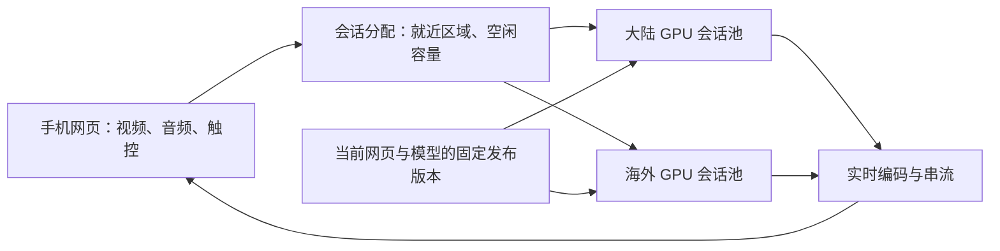

# 《陪我走过小时候的路》云渲染评估

评估日期：2026-11-15。范围：复用当前 Three.js / 3DGS 网页、现有模型与交互，面向大陆及海外手机用户。此轮仅调查与计算，没有创建云资源、产生购买订单或改动线上网站。

## 判断与建议

技术上可复用现有网页：云端 GPU 浏览器加载模型并渲染，手机接收视频和音频、回传触控。应先验证腾讯 CAR 的云 Web，再用自建 GPU 浏览器作为成本与控制能力的对照。无需先移植到 Unreal。腾讯官方明确云 Web 可以运行浏览器并打开指定网址；能否完整承载本作品的 WebGL、3DGS、多点触控和声音，仍须项目实测。[CAR 接入说明](https://cloud.tencent.com/document/product/1547/72707)

希望稳定 2–5 秒开始操作，需要已经加载完成的空闲会话。租到 GPU 或把模型缓存到磁盘，还不等于会话可立即交付。海外先以新加坡为东亚/东南亚预算点；欧美访问量出现后应增加当地池，不能将新加坡当作全球低延迟节点。

现有首玩证据：Apple M2 Max 上 Chromium 触控仿真，390×844、2倍CPU节流、50 Mbps / 80 ms 网络条件，原照406ms出现，场景35.984秒可用，启动请求142.17 MiB。它不是手机真机性能，也不能据此推导 T4 的并发、显存或启动耗时。[本地质量报告](../evidence/deployment/scene-store/quality/sole-city/ae7093baf7a8fe8b70f0b678/report.json)

## 复用边界和部署结构

保留模型、材质、时间线、相机路径、街道行走和碰撞逻辑。原 Netlify 相册可保留；为大陆手机的打开速度，应同时准备就近的小型播放器入口，云端本地镜像固定发布资产，避免新会话临时跨境下载。预热目录应绑定明确版本：本次源发布 e89ebad873b17baa，场景发布 ae7093baf7a8fe8b70f0b678。[部署回执](../evidence/deployment/sole-childhood-20261115/receipt.json)

需要新增的是播放器接入、独立访客会话、排队/重连、区域调度、预热与回收。自建还需维护编码、串流和容器，选择WebRTC时再配置ICE/STUN/TURN；托管平台承担其中多数基础工作，自己的会话后端仍要存在。用户各自控制相机，需要独立运行状态，不能用一路直播复制给100人代替100路交互。

本项目有 mesh 与 Gaussian 两个画布、原照/DOM叠层及独立音频；只捕获 mesh 会漏内容。第一版宜捕获完整应用窗口，再逐步将按钮和摇杆留在手机端以保持清晰。触摸转鼠标可能破坏“摇杆移动+另一指转头”；要验证多 pointerId、竖屏比例、声音解锁和返回恢复。服务器通常不报告 coarse pointer，需显式传递手机配置，避免误用桌面细节策略。[源码](../cases/sole-city/viewer/film.js) · [技术核验](CLOUD_RENDERING_TECHNICAL_NOTES.md)

自建可试 Selkies。当前版本默认 WebSockets，WebRTC需显式选择；不能照搬旧版默认 GStreamer/WebRTC 教程。其桌面共享能力仍需封装成作品专用会话，禁止暴露普通浏览器桌面、文件和剪贴板入口。[官方组件说明](https://docs.selkies.io/latest/components/)

## 服务器和服务怎么选

| 路线 | 起步候选 | 适用判断 |
|---|---|---|
| 托管云 Web | 腾讯 CAR GPU S/M；先用较高档建立基线再降档 | 最快检验当前网页；1路对应1用户，无需猜多租户密度。S/M够用须实测，必要时L |
| 大陆自建 | 腾讯 ECM GN7vw.4XLARGE64，整张T4、16核64GB | 已有渲染驱动/授权配置的公开价候选；节点库存、Linux镜像和开通权限待核验 |
| 海外自建 | AWS新加坡 g4dn.2xlarge，整张T4、8 vCPU / 32 GiB | 明确可核验公开报价；从1、2、4个独立浏览器逐级压测 |
| 北美扩展 | 美东 g6.2xlarge，L4 / 8 vCPU / 32 GiB | 有当地用户后增设；较新编码器不自动意味着更高场景密度 |

T4/L4具备H.264硬件编码。应检查驱动确实执行GPU WebGL与NVENC，而非SwiftShader/软件编码。AI训练卡不能仅按算力选；如A100无NVENC。图形授权、显示器限制、VRAM、CPU与编码吞吐都要计入。每卡2人只是预算假设，4人是待测的更高密度方案；连2人也尚未在本项目测得。[NVIDIA支持表](https://developer.nvidia.com/video-encode-decode-support-matrix) · [AWS驱动说明](https://docs.aws.amazon.com/AWSEC2/latest/UserGuide/install-nvidia-driver.html)

## 托管方案的并发预算

官方标准价，人民币，非促销或合同折扣；S为较低成本档、M为较高档，两者不是本作品性能承诺。S/M普通串流的GPU、CPU、磁盘、带宽包含在并发价中；不要再加一份CVM出网账单。S至少4核/8GB内存/4GB显存，M至少4核/16GB/6GB显存；海外区域需白名单。包月/包天才能使用预启动，小时资源包不能据此承诺秒开。[CAR计费概述](https://cloud.tencent.com/document/product/1547/72167) · [CAR标准价格与限制](https://cloud.tencent.com/document/product/1547/72168)

| 每路并发 | 大陆 | 新加坡 | 北美 | 法兰克福 |
|---|---:|---:|---:|---:|
| S / 月 | ¥1,717 | ¥1,778 | ¥1,720 | ¥1,542 |
| M / 月 | ¥2,620 | ¥2,735 | ¥2,620 | ¥2,481 |

以下按总峰值在大陆、新加坡各占一半，全天保留容量。1人行因地点不确定，仍在两个区域各准备容量。备用数按每区 max(1, ceil(峰值×20%))，用于周转，**不是高可用或绝不排队保证**。

| 总目标同时在线 | 每区基础路数 | 双区基础费 S–M / 月 | 每区含周转路数 | 双区含周转费 S–M / 月 |
|---|---:|---:|---:|---:|
| 1 | 1 | ¥3,495–5,355 | 2 | ¥6,990–10,710 |
| 10 | 5 | ¥17,475–26,775 | 6 | ¥20,970–32,130 |
| 50 | 25 | ¥87,375–133,875 | 30 | ¥104,850–160,650 |
| 100 | 50 | ¥174,750–267,750 | 60 | ¥209,700–321,300 |

业务后端、入口网站、开发运维和可能的税费未包含在表中。S/M若不足，L档大陆/新加坡分别为3765/4648元每路月，须重新计算，不能把M列当作费用上限。两区各5路只能保证该地域分布下的10人容量；若10人全在大陆，不能宣称仍都能就近进入。

平台说明用户退出后清理约1分钟，随后重新预热；按玩5分钟、周转恰为1分钟，稳态需要1.2倍路数。若预热使周转变成2分钟，则需要约1.4倍，短时突发还会更多。单路刚释放时，下一个用户可能仍然等待。[官方会话生命周期说明](https://cloud.tencent.com/document/product/1547/72707) · [预启动刷新说明](https://cloud.tencent.com/document/product/1547/102784)

## 自建 GPU 的成本对照

可核验单价：大陆ECM全T4、16核64GB每月3528元，配置GRID/vDWS；SSD另1元/GB/月。北上广电信/联通公网按日峰值2元/Mbps/天计算，不能把它误当平均流量价格。[ECM实例价格](https://cloud.tencent.com/document/product/1108/55463) · [ECM网络价格](https://cloud.tencent.com/document/product/1108/45463)

AWS新加坡Linux g4dn.2xlarge每小时1.052美元，30天720小时为757.44美元；新加坡互联网出网付费首10240 GB每GB0.12美元，后40960 GB为0.085美元。100 GB免费量为全账户共享。美东T4同规格0.752美元/小时，L4 g6.2xlarge为0.9776美元/小时。源目录版本已固定在证据笔记，未用美区价格冒充亚洲部署价。[新加坡EC2官方目录](https://pricing.us-east-1.amazonaws.com/offers/v1.0/aws/AmazonEC2/20261114012926/ap-southeast-1/index.csv) · [新加坡DataTransfer官方目录](https://pricing.us-east-1.amazonaws.com/offers/v1.0/aws/AWSDataTransfer/20261111191941/ap-southeast-1/index.json) · [海外定价笔记](CLOUD_RENDERING_GLOBAL_PRICING_NOTES.md)

计算统一使用30天、720小时。手机目标约720p像素量、30fps；竖屏可用640×1384左右，勿直接将720×1558当作同样像素成本。按4Mbps视频+15%音频/协议预算=4.6Mbps，即约2.07十进制GB/活跃用户小时。AWS以25%平均在线/峰值计算流量；ECM每天都达到日峰值，不打25%折扣。GB字节换算与实际协议重传会造成账单偏差，表是工程近似。

令每区峰值C、周转备用R=max(1,ceil(0.2C))、每卡密度D，则机器数K=ceil((C+R)/D)。

- 大陆GPU+网络小计：3528×K + 4.6×C×2×30 人民币/月。
- 新加坡GPU+网络小计：1.052×720×K + 阶梯出网费用。月出网约2.07×720×0.25×C GB，仅对新加坡全池扣一次100GB免费量；假设没有其他服务抢占此免费额度。

| 总目标在线 | 每区峰值 | 每卡2人时每区GPU数 | 大陆GPU+网络 / 月 | 新加坡GPU+网络 / 月 |
|---|---:|---:|---:|---:|
| 1 | 1 | 1 | ¥3,804 | US$790 |
| 10 | 5 | 3 | ¥11,964 | US$2,484 |
| 50 | 25 | 15 | ¥59,820 | US$12,467 |
| 100 | 50 | 30 | ¥119,640 | US$24,657 |

**同一行的大陆和海外费用要相加，币种不同，不能二选一或直接相加数字。** 未将浮动汇率写成固定人民币报价。另计磁盘、公网IP、业务/调度服务器、TURN、中间网络、日志、税及运维。AWS每个公网IPv4为0.005美元/小时，720小时3.60美元。若TURN在同区私网接收GPU流再出公网，不必然发生两次公网出网；跨区、跨云和NAT处理费需按实际路径另算。[AWS公网及NAT价格](https://aws.amazon.com/vpc/pricing/)

密度敏感性：若压测证实4人/卡，10人双区需要2+2台，大陆小计约8436元、新加坡1726美元/月；100人需要15+15台，约66720元+13295美元/月。若只能1人/卡，则上述2人/卡的GPU部分约翻倍，网络不变。自建是否划算主要取决于实际密度与运维投入，不能预先保证比托管便宜。

流量敏感性：100人峰值、海外50人，如果平均在线从25%升至100%，海外2人/卡方案的小计约从24657升至29338美元/月。GPU全天运行部分不变。按计划每天只开6小时可减少自建GPU计费时长，但其余时间无法保证随到随玩；CAR包月价不会因为每天只用6小时自动打四分之一折扣。

## 手机上多快能玩

以下是尚未实测的工程预算/目标，前提是同区域、无排队、4G/5G/Wi-Fi稳定，入口与资产已准备。首玩时间定义为用户打开入口后，收到可见画面且触控已能控制场景；不包括用户自行延迟点击声音授权的时间。

| 状态 | 首玩预算 | 解释 |
|---|---|---|
| 空闲会话已 ready，场景与着色器已加载 | 2–5秒目标，P95先争取≤8秒 | 仍需入口、会话分配、媒体连接和首个关键帧 |
| 自建VM已开、资产在本地，但新建浏览器进程 | 10–40秒预估 | 解码、显存上传、编译和预热依然要做 |
| 自建冷VM/扩容，已有预制镜像 | 1–5分钟规划范围 | 缺库存、下载镜像或启动失败可能更久 |
| CAR上一用户刚退出或预热池耗尽 | 排队/回收时间另加 | 平台清理约1分钟，随后还要应用预热 |

热会话2–5秒是本项目要验证的目标，厂商“秒开”描述不等于我们已经达成。腾讯预启动功能和生命周期提供了机制依据，具体时延不由现有Mac测试推导。[预启动机制](https://cloud.tencent.com/document/product/1547/102784)

操作延迟与进入速度不同：验收可先定同区域输入到画面变化P95≤150–200ms，30fps稳定；这也是目标而非测得数值。海外跨洲或大陆跨境连接不能承诺此数值。对欧美用户，需加美洲/欧洲会话池和对应热容量，不能只把静态页面接CDN就消除渲染往返延迟。

## 手机流量与画质

云渲染移走模型下载、模型解码与3D绘制，手机仍要联网解码视频。2–4Mbps加15%开销，每分钟约17–35MB，5分钟约86–173MB。它解决初次等待和手机GPU压力，长时间游玩可能比下载一次模型更耗流量。弱网可降分辨率/码率，但老街细字、雨水反光和细密纹理可能出现压缩损失，需要视觉对照。

播放器初始目标为不加载GLB/SPZ，先显示小封面；首屏静态载荷控制在1–2MB以内是后续实现目标，尚未制作。手机保留必要触控和轻量UI，声音由用户手势解锁。静止时降低码率、离开页面断开/释放会话，但重连保留多久需要与费用权衡。

## 最小验证与采购依据

建议先做大陆与新加坡各1路的功能原型：按标准日价S合350元/天，M合536元/天；单路不能验证周转并发。若验证每区2路接替，S合700元/天，M合1072元/天。海外开通和库存需先确认；这些是资源预算，不含开发工时，也未实际购买。若S/M不足需增加L成本。[CAR日价](https://cloud.tencent.com/document/product/1547/72168)

1. 固定当前发布，完整捕获原照、3DGS、街景和声音。自建确认真实GPU WebGL+NVENC；托管使用平台提供的诊断与端到端表现验收，不假设能查看底层驱动。
2. iPhone Safari、Android Chrome和需要支持的微信内置浏览器实测：竖屏、双指行走、声音、后台恢复、移动网切换。
3. 记录至少20次热连接、10次冷连接和10次接替；统计URL打开→可操作P50/P95，以及输入到画面延迟。分别记录大陆电信/联通/移动和海外目标地区。
4. 自建同卡1、2、4会话并行跑最重街口、近景建筑、反射和3DGS切换，持续至少20分钟；记录GPU帧时、CPU、系统RAM、VRAM、编码耗时、丢帧与手机实际接收码率。托管按独立并发同时运行、平台可见诊断与手机端帧率/时延/码率验收。容量依据是全程最坏情况，不是GPU百分比或单一截图。
5. 以实测的每卡密度、平均游玩时长、回收预热耗时和地区流量比例重算预算，再选正式档位与备用池。100人活动须事先落实库存和容量，不能把临时扩容作为秒开保障。

详细证据：[大陆价格核验](CLOUD_RENDERING_CHINA_PRICING_NOTES.md) · [海外价格核验](CLOUD_RENDERING_GLOBAL_PRICING_NOTES.md) · [代码及技术适配核验](CLOUD_RENDERING_TECHNICAL_NOTES.md)。
